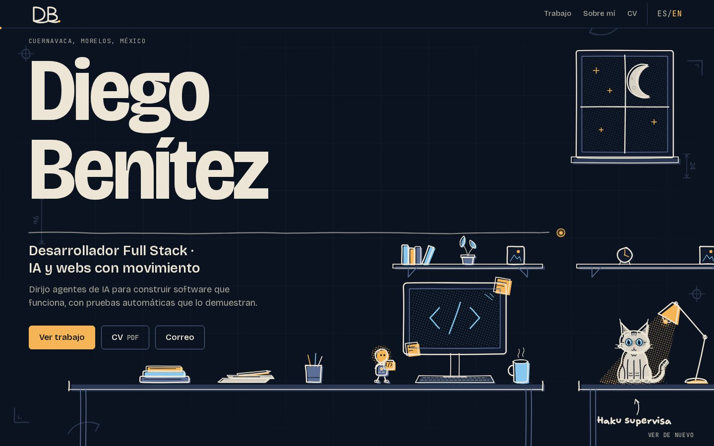
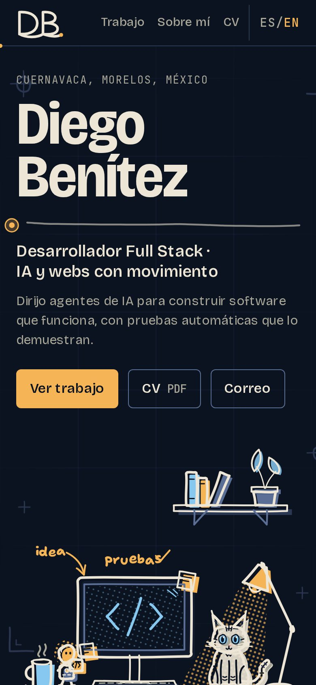

# Portafolio de Diego Benítez

Sitio personal de un desarrollador full stack que construye productos con IA y webs con movimiento. Está
pensado para quien contrata o revisa trabajo técnico: cada proyecto se cuenta con qué problema resolvía, cómo
funciona, qué se midió y qué parte hizo Diego. Bilingüe (español en `/`, inglés en `/en/`), estático y sin
servidor propio.





## La idea

- **Una sola línea** dibuja el sitio: sale del subrayado del nombre, se vuelve el escritorio y baja por cada proyecto.
- Una **chispa** ámbar la recorre con el scroll; donde llega, las cosas se dibujan y hacen algo.
- **Haku**, el gato de Diego, es el guía: camina por la parte baja de la ventana, se sienta y comenta cada escenario.
- Cada proyecto es un **escenario a todo lo ancho** con su prueba real en grande y un invento dibujado que se mueve.
- El texto se lee sin esperar a ningún dibujo; con `prefers-reduced-motion`, todo queda quieto y completo.

El guion completo está en `MUNDO.md`; los colores, la letra y las reglas de honestidad, en `DIRECCION.md`.

## Cómo está hecho

- **Next.js 16** (App Router) + React 19 + TypeScript estricto + Tailwind 4, con `output: "export"`: el build deja
  HTML, CSS y JS en `out/` y cualquier servidor de archivos lo sirve.
- **Contenido en Markdown** (`contenido/`) con frontmatter validado por **zod**: un campo que falta rompe el build
  con el archivo y el campo. Si falta un `.en.md`, la página en inglés usa el español y lo avisa.
- **Kit de dibujo por datos** (`dibujo/`): cada ilustración es geometría limpia en un `.mjs`; al generar, `roughjs`
  la pasa a trazo de marcador con tres cuadros de hervor y la guarda como JSON en `components/dibujo/datos/`. El
  navegador no carga `roughjs`: recibe el SVG ya hecho (el servidor pinta el cuadro 1; los otros dos se piden al
  acercarse).
- **Movimiento**: GSAP (ScrollTrigger, SplitText) registrado en un solo lugar (`lib/gsap.ts`) y Lenis para el
  scroll. `motion` solo para lo que responde a la mano, y siempre perezoso (en un trozo aparte).
- **Línea viva**: un `<path>` que se calcula en el navegador con las posiciones reales de cada escenario; busca su
  camino con A* sobre una rejilla para no cruzar texto, botones ni vistas (`components/mundo/geometria.ts`).
- **Estados ocultos solo bajo `html.mueve`**: un guion del `<head>` pone `js` y `mueve` antes de pintar; sin
  JavaScript o sin movimiento, nada se queda escondido.
- **Imagen para compartir** generada al compilar con `next/og` a partir del mismo dibujo del kit (`lib/imagenOg.tsx`).

## Carpetas

| Ruta | Qué hay |
|---|---|
| `app/(es)/`, `app/(en)/en/` | Los dos root layouts (español e inglés), inicio, casos, laboratorio y `og.png` |
| `app/global-not-found.tsx` | La 404 de todo el sitio, bilingüe, con Haku tirando la taza |
| `app/hervor/` | Publica como JSON estático los cuadros de hervor de cada dibujo |
| `components/paginas/` | Inicio (escenarios), página de caso, cabecera, pie y la 404 |
| `components/mundo/` | La línea viva, Haku guía, los inventos, la tira, el tráfico y las estaciones |
| `components/dibujo/` | `<Dibujo>` (servidor), `<DibujoVivo>` (cliente) y los datos generados |
| `components/plano/`, `escenas/` | Los diagramas animados de «cómo funciona» de cada caso |
| `components/movimiento/` | Lenis, revelados, contadores y copiar el correo |
| `dibujo/` | El kit: `kit/` (formas, estilo, hornear), `piezas/` (una ilustración por archivo) y laboratorio |
| `contenido/` | Perfil, casos y «más», en `.es.md` y `.en.md` |
| `lib/` | Lector de contenido, idiomas, textos, metadatos, fuentes, GSAP y guion de arranque |
| `demos/crm/` | Fuente de la demo interactiva que se publica en `public/demo/` |
| `pruebas/` | Pruebas con `node --test` y un contenido de ejemplo |
| `scripts/` | Las compuertas de abajo, capturas, recorrido e iconos |

## Correrlo

Node 24 (`.nvmrc`).

```bash
npm ci
npm run dev                     # desarrollo en http://localhost:3200
npm run build && npm run start  # sitio estático servido desde out/ en http://localhost:3210
node dibujo/generar.mjs         # rehace los datos de los dibujos (antes: cd dibujo && npm ci)
```

Variables: `NEXT_PUBLIC_SITIO` (dirección pública para canonical, hreflang, sitemap, JSON-LD y la imagen para
compartir) y `CONTENIDO_DIR` (por omisión `contenido`; `pruebas/contenido-ejemplo` corre sin el contenido real).

## Verificación

`npm run check` es la puerta antes de cada commit. Las de navegador corren con el sitio servido, con
`nice -n 19 taskset -c 0-3` delante.

| Comando | Qué garantiza |
|---|---|
| `npm run check` | Tipos, lint, pruebas de `pruebas/`, build, `privacidad` y `demo-limpia`, en ese orden |
| `npm run privacidad` | En `out/` no hay teléfonos, enlaces `tel:` ni `wa.me`, ni marcas `PENDIENTE` |
| `npm run demo-limpia` | La demo del CRM no contiene nombres del proyecto privado del que salió (lista en hashes) ni mapas de fuente |
| `node scripts/linea.mjs / /en/` | La línea no pisa texto ni vistas, pasa por cada ancla en orden y la chispa llega al pie (390, 834 y 1440 px) |
| `node scripts/nada-oculto.mjs / /en/` | Tras bajar despacio, todo título y bloque revelable se ve, con y sin movimiento |
| `node scripts/guia.mjs / /en/` | Nunca hay dos Haku a la vista y sus globos no tapan texto, botones ni vistas |
| `node scripts/carga.mjs /` | Mide el costo de cargar en perfil de celular con CPU ×4: tareas largas, TBT aproximado, layout |

## Rendimiento

Números medidos que constan en el historial o en el código (Lighthouse en celular; la meta es 95):

- Con todo el mundo dibujado montado a la vez: de 54 a 84 en Lighthouse móvil (`519cf60`).
- La letra de los rótulos, instanciada solo con lo que se usa: de 167 a 101 KB (`d356768`), y se carga después de
  `load` (`lib/arranque.ts`).
- Sin las caras `latin-ext` de `next/font`: 68 KB menos en la carga inicial (`lib/fuentes.ts`).
- El hervor fuera del HTML: los cuadros 2 y 3 de cada trazo eran ~35 % del documento del inicio
  (`components/dibujo/hervor.ts`).
- El nombre de la portada entra con CSS, sin esperar a GSAP, por el LCP (`938d69b`).

## Honestidad

Sin teléfono en ningún lado; el único contacto es el correo. Sin nombres de clientes ni ingresos. Solo cifras
medidas en los repositorios, con su fecha. Los repositorios privados se dicen privados. (`DIRECCION.md` §8)

## Cómo se construyó

Diego dirigió agentes de IA (Claude Code) para escribir el código: él decide qué se construye, cómo se ve y qué
entra. El trabajo se reparte en ramas paralelas, una por pieza, y cada rama pasa por la misma compuerta antes de
unirse: revisión visual con capturas a tamaño real (escritorio y celular, con y sin movimiento) y las pruebas
automáticas de la tabla de arriba. Lo que no pasa no entra. Las decisiones de dirección, los guiones y las
correcciones de cada ronda están escritos en `MUNDO.md`, `DIRECCION.md` y en los mensajes de commit.

## Trampas ya pagadas

- Enlaces internos con `<a>`, no `<Link>`: en la exportación estática la precarga de `<Link>` pide archivos que dan 404.
- Los tokens de `app/tokens.css` van en un `:root` sin `@layer`.
- Playwright va fijo en 1.63.0: es la versión del Chromium que ya está en la caché.

## Publicación

El sitio se publica en GitHub Pages: <https://skytoti.github.io/>. `scripts/publicar-pages.sh` compila con la
dirección pública, pasa todas las compuertas y sube el resultado (rama `gh-pages`) y el código (rama `main`).

## Licencia

© 2026 Diego Javier Benítez Castellanos. Todos los derechos reservados. El código es público para que pueda leerse y
evaluarse; el diseño, las ilustraciones, el personaje Haku, los textos y los medios no pueden copiarse ni reutilizarse
sin permiso. Ver [LICENSE](LICENSE).
